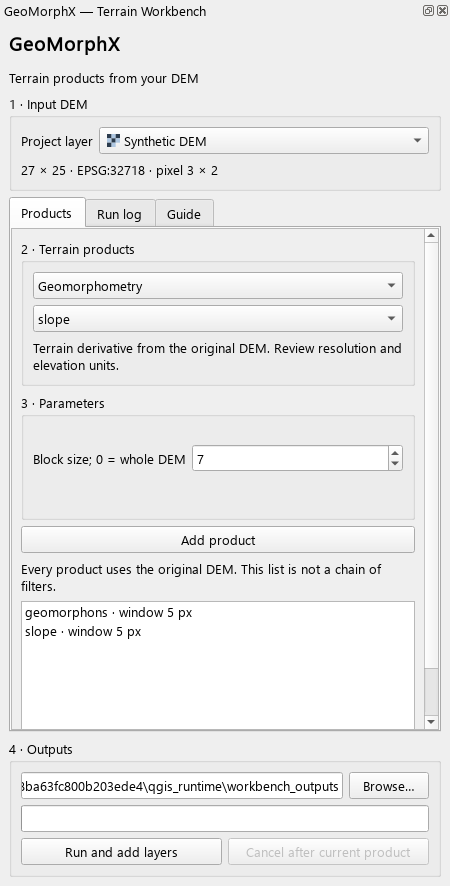

# GeoMorphX

**Terrain analysis and multiscale relief visualization in QGIS.**

English | [Español](README.es.md)

GeoMorphX is an experimental QGIS plugin for exploring digital elevation models
(DEMs). Select a project layer, prepare terrain products, save a reusable recipe
and add the results to your map. The same Python core powers the dock, Processing,
the Python API and command-line automation.

**Plugin 0.5.1 · Core 0.1.0 · GPL-3.0-or-later**

## Install

Install a GeoMorphX plugin ZIP using **Plugins → Manage and Install Plugins →
Install from ZIP** in QGIS. Enable GeoMorphX, then open **Raster → GeoMorphX →
GeoMorphX Terrain Workbench** or its toolbar button.

If you have a source checkout rather than a ZIP, build one from the repository
root with Python 3.10 or newer:

    python scripts/build_qgis_plugin.py --out-dir dist/qgis

Install the generated ZIP, not an archive of the entire repository. The ZIP
contains the Python core, both language guides, recipe schema and examples.
Building this ZIP uses the Python standard library; it does not compile Rust.
Generated archives are local artifacts and are excluded from Git.

The plugin uses NumPy and GDAL supplied by QGIS. Rasterio is optional; the native
GDAL adapter handles raster I/O when Rasterio is absent. No dependency installer
changes the QGIS interpreter. Restart QGIS after replacing an already loaded
GeoMorphX version.

The declared range is **QGIS 3.28–3.x**. Integration has been checked on **QGIS
3.44.12, Windows, Python 3.12**. Other platforms and versions still need testing.
The plugin has not been submitted to the official QGIS plugin repository.

## Start with a DEM

1. Add a local, single-band DEM to your QGIS project. Use a projected CRS,
   a north-up grid and matching horizontal and elevation units.
2. Select it in the workbench and choose a method and its parameters.
3. Click **Add product** for each desired result. Every product uses the original
   DEM; the list does not chain derivatives together.
4. Choose an output directory and click **Run and add layers**.
5. Review the added layers, metadata and **Run log**. Geomorphon classes receive
   a categorized legend.

Each panel run creates a new folder with GeoTIFFs, metadata sidecars and JSON run
manifests. Completed outputs are retained on failure or cancellation. Cancellation
is checked between products; the current product finishes first.

## Tools

| Family | Included products |
| --- | --- |
| Relief visualization | Classic RRIM generator and RGB composer; seven experimental RRIM variants |
| Illumination and openness | Hillshade, multidirectional hillshade, positive/negative openness and sky-view factor |
| Terrain derivatives | Slope, aspect, profile/plan/mean curvature |
| Local terrain context | TPI, local relief, Riley TRI and a wetness proxy |
| Terrain forms | Ten-class line-of-sight geomorphons, canonical patterns and a separate legacy simplified model |
| Additional hydrology | Depression filling, D8/MFD accumulation and TWI, D8 direction, outlet basins and flow length |

Processing exposes **43 tools**: the 32 shared methods as individual algorithms
and 11 suite, block, classic RRIM, benchmark and recipe tools. They can be used
in batch jobs and Model Designer. Existing provider and algorithm identifiers
are retained. The main focus is geomorphometry and relief visualization.

## Automate the same workflow

A portable JSON recipe works in the panel, Processing, CLI and Python API.
Older panel and recommendation recipes remain readable. For example, in the
QGIS Python console with GeoMorphX enabled:

    import processing

    result = processing.run("geomorphx_rrim_suite:run_recipe", {
        "INPUT_DEM": "D:/data/dem.tif",
        "RECIPE": "D:/recipes/terrain.json",
        "OUT_DIR": "D:/results/run_001",
    })

Use a fresh output directory for each recipe execution. See the
[automation guide](docs/AUTOMATION.md) for Python, CLI, legacy formats,
cancellation, manifests and runnable examples.

## Scientific status and limits

- Windows and scales are in pixels. Elevation units are not inferred or
  converted; confirm that they match the horizontal units.
- Local products use blocks with halos. Experimental RRIM uses global
  normalization with retained scratch rasters. Hydrology still needs the full
  DEM in memory, even when a block size is requested.
- The seven RRIM core variants are experimental compositions with a legacy
  unit-pixel convention. Their equivalence to classical RRIM is not validated.
  The classic generator/composer remain separate tools.
- Geomorphons implements the documented basic comparison, not all GRASS options.
  Independent executable and field comparisons remain pending.

The latest source suite passed **162 tests**, with **9 Rust tests skipped**
because the extension was absent from that checkout. Real QGIS tests used an
isolated profile and offscreen Qt widgets, including all 43 tools and shared
recipes. These are integration and synthetic checks, not field validation.
See [status and known issues](docs/STATUS.md), including the legacy RGB export
diagnostic and remaining manual/platform tests.

## Documentation and development

- [User guide](docs/USER_GUIDE.md)
- [Automation and recipes](docs/AUTOMATION.md)
- [Geomorphon method and classes](docs/GEOMORPHONS.md)
- [Memory, tiling and optional hydrology](docs/SCALABILITY.md)
- [Development and packaging](docs/DEVELOPMENT.md)
- [Documentation index](docs/README.md) · [Documentación en español](docs/README.es.md)

QGIS is the primary desktop interface. The API and CLI remain available for
automation; the standalone GUI is retained as a secondary compatibility
interface. Rust accelerates selected kernels in the optional Python package.
See [LICENSE](LICENSE) for software licensing.
